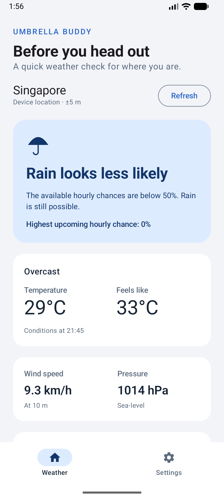
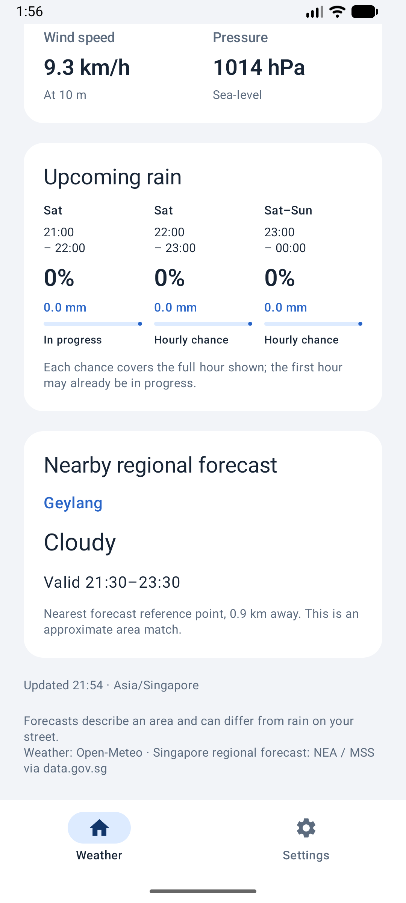
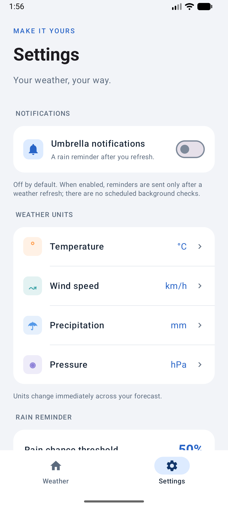

# Umbrella Buddy

Umbrella Buddy is an Android utility app that helps answer a simple question: **Should I bring an umbrella?**

The app uses the device's current location to show weather conditions, upcoming hourly rain chances and umbrella advice. In Singapore, it also shows a nearby regional forecast.

## Screenshots

| Current-location weather | Hourly and regional forecast | Settings and units |
| --- | --- | --- |
|  |  |  |

[View the rain reminder and location settings](docs/screenshots/reminder-settings.png).

Screenshots were captured from the running app using live weather data. Forecast values and times will change when refreshed.

## Features

### Weather

- Get weather for the device's current location.
- View temperature, feels-like temperature, wind speed and sea-level pressure.
- See rain probability and precipitation amounts for upcoming hourly periods.
- Receive umbrella advice based on current conditions, hourly rain chances and available regional forecasts.
- Refresh the forecast and recover from location or network errors.

### Nearby Singapore forecasts

When the device's location is identified as Singapore, the app retrieves the official two-hour regional forecast and matches the nearest available forecast reference point.

The regional card displays the area name, forecast description and validity period. If regional data is unavailable, the basic coordinate-based weather remains available.

### Settings

Settings apply immediately to the weather screen.

| Setting | Options |
| --- | --- |
| Temperature | Celsius, Fahrenheit |
| Wind speed | km/h, m/s, mph, knots |
| Precipitation | Millimetres, inches |
| Pressure | hPa, mbar, inHg, mmHg |
| Rain chance threshold | 10%-90%, in 10% steps |
| Umbrella notifications | On or off |

Preferences remain available during the app session, including screen rotation and forecast refreshes. They reset after a full app process restart.

### Notifications

Umbrella notifications are off by default.

When enabled and permitted by Android, the app sends a reminder after a successful weather refresh if the forecast recommends an umbrella. Repeated refreshes of the same forecast do not repeatedly alert the user.

Tapping the notification opens the app. Turning reminders off cancels the existing reminder notification.

The app does not perform scheduled background weather checks.

## How umbrella advice works

The app recommends bringing an umbrella when any of these conditions apply:

- Current weather indicates precipitation.
- A currently valid nearby regional forecast indicates rain or showers.
- An upcoming hourly rain probability reaches the selected threshold.

The default threshold is **50%**. Missing rain probabilities are treated as unavailable information, rather than as a 0% chance.

Each hourly probability applies to the full period displayed. The first period may already be in progress. The highest hourly probability is shown separately; it is not presented as a combined probability for several hours.

## Technology and structure

The app uses:

- **Kotlin** for application logic.
- **Jetpack Compose and Material Design 3** for the interface.
- **ViewModel and StateFlow** for screen state and preferences.
- **Kotlin coroutines** for asynchronous operations and cancellation.
- **Retrofit, Gson and OkHttp** for weather requests.
- **Android location APIs and Geocoder** for location, area and country identification.
- **Android notification APIs** for optional umbrella reminders.

The main responsibilities are separated as follows:

| Component | Responsibility |
| --- | --- |
| `UmbrellaApplication` and `AppContainer` | Create and share application dependencies |
| `AndroidLocationProvider` | Obtain a recent device location and optional area information |
| `DefaultWeatherRepository` | Request and combine weather data |
| `WeatherDataMapper` | Validate API responses and select hourly periods |
| `AreaForecastMatcher` | Match a nearby Singapore forecast reference point |
| `WeatherViewModel` | Manage loading, results, errors and preferences |
| `WeatherScreen` and `SettingsScreen` | Display weather and user controls |
| `AndroidRainNotifier` | Check notification access and manage reminders |

## Running the app

1. Clone or download this repository.
2. Open the project in Android Studio.
3. Install Android SDK 36 and allow Gradle to sync.
4. Use Android Studio's bundled Gradle JDK. Local verification used JDK 21.
5. Run the app on an emulator or Android device with **API 26 or higher**.
6. Tap **Use my location** and allow approximate or precise location.
7. Enable **Umbrella notifications** in Settings if notifications are wanted. Android 13 and later also require notification permission.

An internet connection is required for weather requests and may be needed for area-name lookup.

### Emulator location

The emulator's virtual location may differ from the computer's actual location.

To test another location, open the emulator's **Extended Controls > Location > Single points**, select a point and choose **Set Location**. Then return to the app and tap **Refresh**.

## Permissions

| Permission | Purpose |
| --- | --- |
| Internet | Retrieve weather and regional forecast data |
| Approximate or precise location | Request weather for the device's current position |
| Notifications | Display optional umbrella reminders |

The app requests foreground location access and does not request background location permission.

Device coordinates are sent to the weather service to retrieve a forecast. Location coordinates are not saved to persistent app storage.

## Testing

Build and run local checks on Windows:

```powershell
.\gradlew.bat :app:assembleDebug
.\gradlew.bat :app:testDebugUnitTest
.\gradlew.bat :app:lintDebug
```

Run standard emulator tests with:

```powershell
.\gradlew.bat :app:connectedDebugAndroidTest
```

Live API, location and notification-delivery checks require explicit instrumentation arguments and the relevant user-granted permissions. These checks are skipped during a normal test run unless enabled.

### Latest local verification

Verification was performed on a **Medium Phone API 37.0 emulator**.

- **67 unit tests passed.**
- The full device verification discovered **20 tests: 19 passed and one was skipped** because location permission had already been granted.
- Live location verification identified Singapore and matched the nearby Geylang regional forecast.
- Actual notification posting, duplicate suppression, tap-to-open and cancellation passed after the user allowed notifications.
- App compilation and Android lint checks passed with no lint errors. Dependency/version and starter-resource warnings remain.

Notification-delivery tests use a controlled rainy forecast. This test data is confined to instrumentation tests and does not replace live weather in the application.

## Limitations

- Forecasts describe an area and may differ from conditions on an individual street.
- Singapore regional matching uses reference points, not exact district boundaries.
- Regional nowcasts cover Singapore only.
- Area-name lookup and external services may be temporarily unavailable.
- There is no offline forecast cache.
- Preferences are stored in memory rather than persistent storage.
- New notifications require a successful weather refresh; there is no background monitoring.
- Physical-device testing has not yet been performed.

## Acknowledgements and data sources

- Project scaffold: lecturer-provided **MobileTech Utility App** starter for CP3406.
- Weather data: [Open-Meteo](https://open-meteo.com/) and its [Forecast API documentation](https://open-meteo.com/en/docs).
- Singapore regional forecasts: **NEA / MSS**, accessed through [data.gov.sg's Two-hour Weather Forecast dataset](https://data.gov.sg/datasets/d_3f9e064e25005b0e42969944ccaf2e7a/view).
- Networking library: [Retrofit](https://square.github.io/retrofit/).
